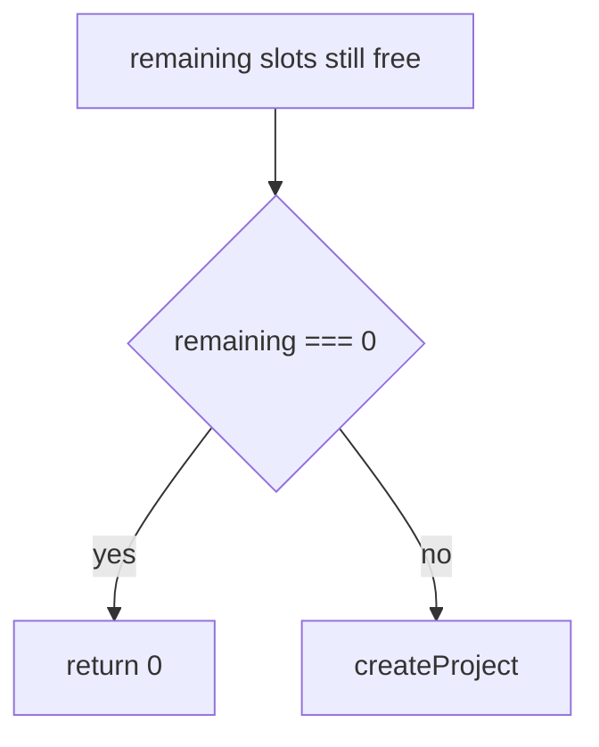

# Examples

## Full note

Diff:

```ts
const remaining = Math.max(0, limit - used)
if (remaining === 0) return 0
return remaining
```

`createProject` in `projects.ts` already returns early on that check. One `if` needs no diagram.

~~~~markdown
PR-DIFF-EXPLAIN-AGENT
```text
remaining (slots still free) = Math.max(0, limit (daily cap) - used (slots already taken))
if remaining === 0
      return 0
return remaining
```

**Pattern:** Current code already returns before create when the cap is hit. Same as `createProject` in `projects.ts`.
~~~~

## Not the same behaviour

This block checks a role, not the cap. It gets its own pseudocode.

```text
if user.role (permission level) !== "admin"
      return
```

## Diagram, when order is hard

Use this when the block branches more than once or hands off across files. Same names as the diff.



## Deletion-only

Comment side is `LEFT`. Pseudocode still names what was removed.

```text
remove gone (flag that forced the old path)
remove also (second flag on that path)
```

## Format-only

```text
PR-DIFF-EXPLAIN-AGENT
indent
```
