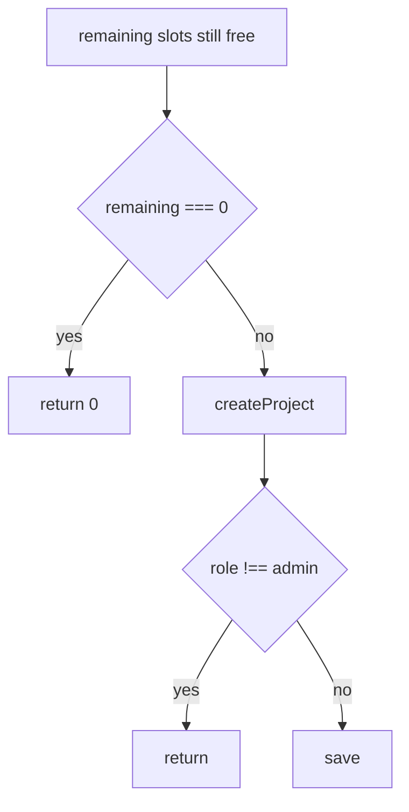

# Examples

## Full note

Diff:

```ts
const remaining = Math.max(0, limit - used)
if (remaining === 0) return 0
return remaining
```

The PR body says create stops when the daily project cap is used up. `createProject` in `projects.ts` already returns early on that check.

~~~~markdown
<!-- pr-diff-explain -->
**Verified:** Create stops when today's project cap is used up. Source: PR body.

**Pattern:** Current code already returns before create when the cap is hit. Same as `createProject` in `projects.ts`.

```text
remaining (slots still free) = Math.max(0, limit (daily cap) - used (slots already taken))
if remaining === 0: return 0
return remaining
```
~~~~

No diagram. One `if` is already clear.

## Reference note

A later handler does the same cap check before create. The full note above is already on the PR.

```markdown
<!-- pr-diff-explain -->
This was already explained in https://github.com/acme/app/pull/12#discussion_r100. Same daily cap check reused here.
```

## Not the same behaviour

This block checks a role, not the cap. It gets its own full note. It does not point at the cap comment.

```text
if user.role (permission level) !== "admin": return
```

## Diagram, only when order is hard

Use this when the block branches more than once or hands off across files. Same names as the diff.



## Deletion-only

Comment side is `LEFT`. Pseudocode still names what was removed.

```text
remove gone (flag that forced the old path)
remove also (second flag on that path)
```

## Format-only

```markdown
<!-- pr-diff-explain -->
Indentation only. No behaviour change.
```
